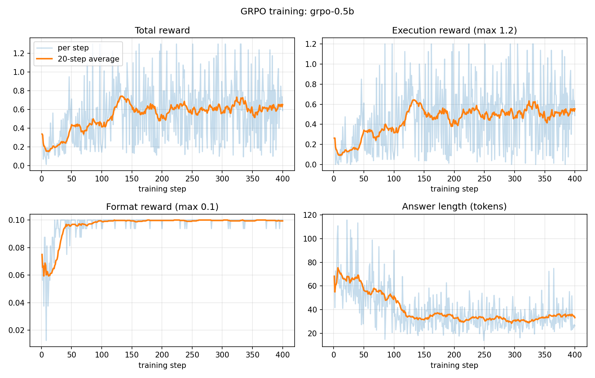
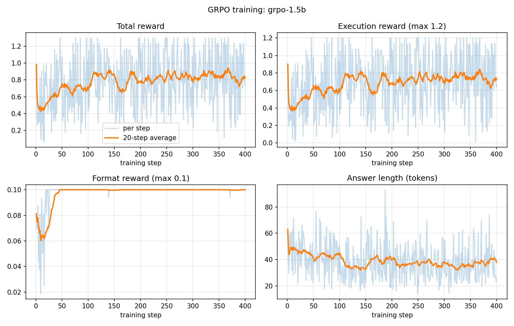

# SQL-GRPO

> Training small open LLMs with reinforcement learning (GRPO) to write correct SQL — and measuring how close they get to a frontier API model at a fraction of the cost.

**🚀 [Try the live demo](https://huggingface.co/spaces/bimal2004/sql-grpo-demo)** — ask a database a question and compare the untrained and GRPO-trained models side by side.

## Headline results

- **Qwen2.5-1.5B: 40.72% → 57.74%** execution accuracy on Spider dev (+17 points), closing **about half the gap** to gpt-4.1-mini (74.37%).
- **Qwen2.5-0.5B: 18.18% → 41.68%** (2.3×) — the trained 0.5B model **beats the untrained 1.5B model**, which is 3× its size.
- Each model trained in a few hours on a **free Kaggle T4 GPU**, with no human-labeled feedback: the database itself is the judge.

## How it works

1. **Prompt** = database schema + natural-language question
2. **Model** generates a group of 8 candidate SQL queries per question
3. **Reward** runs each query on SQLite and scores it:

| Component | Score | Rule |
| --- | --- | --- |
| Execution match | +1.0 | Returns the same rows as the gold SQL |
| Valid SQL | +0.2 | Runs without error |
| Format | +0.1 | Answer inside `<sql>...</sql>` tags |
| Length penalty | −0.1 | Output longer than 1,500 characters |

4. **GRPO** compares each answer to its group's average and pushes the model toward the better ones — no separate critic model, so it fits on a free 16GB GPU.

**Safety:** every query runs on a read-only connection, only `SELECT`/`WITH` statements are allowed, and queries are killed after 2 seconds — so a bad model output can never modify data or hang training.

## Results

| System | Accuracy (%) | Valid SQL (%) | Format (%) | Cost / 1k queries ($) |
| --- | --- | --- | --- | --- |
| Qwen2.5-0.5B-Instruct (untrained) | 18.18 | 35.40 | 66.73 | 0.00* |
| **Qwen2.5-0.5B + GRPO** | **41.68** | **73.21** | **99.81** | 0.00* |
| Qwen2.5-1.5B-Instruct (untrained) | 40.72 | 58.41 | 76.89 | 0.00* |
| **Qwen2.5-1.5B + GRPO** | **57.74** | **82.40** | **100.00** | 0.00* |
| gpt-4.1-mini (prompted) | 74.37 | 98.74 | 100.00 | 0.21 |

*Spider dev set, 1,034 questions on databases **not seen during training**. Execution accuracy = the predicted SQL returns the same rows as the gold SQL (order enforced only when the gold query uses `ORDER BY`).*
\* *Run on a free Kaggle T4; no per-query API cost.*

### Accuracy by question type (1.5B)

| Gold SQL contains... | n | Untrained | GRPO | Gain |
| --- | --- | --- | --- | --- |
| Aggregation | 549 | 41.3% | 59.6% | +18.3 |
| GROUP BY | 277 | 33.2% | 48.7% | +15.5 |
| Nested query | 159 | 27.7% | 39.6% | +11.9 |
| JOIN | 408 | 31.9% | 41.9% | +10.0 |

GRPO improved every question type — not just formatting. JOINs and nested queries remain the hardest (~40%).

### Training curves

| 0.5B | 1.5B |
| --- | --- |
|  |  |

## Findings

1. **Two learning phases.** The format reward saturates first (~step 80 for 0.5B, ~step 45 for 1.5B); the execution reward keeps climbing until ~step 150 as the model learns to write SQL that returns the right rows.
2. **Both model sizes plateau around step 150.** Since the plateau appears at the same point for both sizes, the limit is likely the training setup (2 questions per step, a fixed reward, the same data) rather than training length.
3. **Bigger models gain differently.** For 0.5B, correctness *among well-formatted answers* rose from ~27% to ~42% — real new SQL skill. For 1.5B it rose from ~53% to ~58%, with more of the gain coming from reliably following the output format. The larger model already knew more SQL; GRPO mostly taught it to apply that knowledge consistently.
4. **Shorter, cleaner answers.** Answer length fell (0.5B: ~65 → ~30 tokens; 1.5B: ~48 → ~37) as models stopped adding explanations. This was not forced by the length penalty, which only applies above 1,500 characters.
5. **Borderline answers are sensitive to numerics.** A few questions the trained model answered correctly in evaluation flip when run under slightly different conditions (precision, batching, merged vs. unmerged LoRA). Confident answers stay stable; the 1,034-question evaluation, not any single example, is the reliable measure.

## Failure analysis (1.5B + GRPO)

Of 437 remaining failures (categories are keyword-based heuristics, so approximate):

| Failure category | Count | % of failures |
| --- | --- | --- |
| Error: wrong column name | 150 | 34.3% |
| Valid SQL, same structure, wrong details (values/conditions) | 106 | 24.3% |
| Missing or unnecessary JOIN | 91 | 20.8% |
| Missing or unnecessary nested query | 32 | 7.3% |
| Other | 58 | 13.3% |

**The #1 remaining problem is schema linking:** the model references columns that don't exist. Because SQLite reports these errors explicitly (`no such column: ...`), a **self-correcting agent** — one that runs its query, reads the error, and retries — could plausibly fix many of them. That's the planned next step.

## Demo

The [Gradio demo](https://huggingface.co/spaces/bimal2004/sql-grpo-demo) runs on Hugging Face ZeroGPU. It loads the 1.5B model once and toggles the LoRA adapter off and on, so a single model shows both the untrained and trained answers. Each answer is executed against the real Spider database and the returned rows (or the error) are shown.

## Use the trained models

```python
from transformers import AutoModelForCausalLM, AutoTokenizer
from peft import PeftModel

base = AutoModelForCausalLM.from_pretrained("Qwen/Qwen2.5-1.5B-Instruct")
model = PeftModel.from_pretrained(base, "bimal2004/sql-grpo-1.5b")
tokenizer = AutoTokenizer.from_pretrained("bimal2004/sql-grpo-1.5b")
```

Models: [bimal2004/sql-grpo-1.5b](https://huggingface.co/bimal2004/sql-grpo-1.5b) · [bimal2004/sql-grpo-0.5b](https://huggingface.co/bimal2004/sql-grpo-0.5b) (LoRA adapters)

Prompt format: a system message asking for one SQLite query inside `<sql></sql>` tags, then the database schema and question (see `src/data.py`).

## Stack

- **Training:** Unsloth + Hugging Face TRL (`GRPOTrainer`), LoRA (rank 32), Kaggle T4 GPU
- **Data:** Spider (7,000 train / 1,034 dev questions across 200 SQLite databases; 6,289 train examples after filtering very long schemas)
- **Reward / eval:** Python + SQLite (runs locally, no GPU)
- **Baselines:** untrained Qwen2.5-0.5B/1.5B-Instruct and OpenAI `gpt-4.1-mini`, all with the same prompt
- **Demo:** Gradio on Hugging Face Spaces (ZeroGPU)

## Repo structure

```
sql-grpo/
├── app.py                   # Gradio demo (Hugging Face Space)
├── requirements-space.txt   # dependencies for the Space
├── configs/                 # training configs (0.5b.yaml, 1.5b.yaml)
├── scripts/
│   ├── download_spider.py   # download + checksum-verify Spider databases
│   ├── plot_training.py     # training curves from trainer_state.json
│   ├── analyze_failures.py  # failure categories + accuracy by question type
│   └── deploy_space.py      # upload the demo to a Hugging Face Space
├── src/
│   ├── data.py              # load Spider, build prompts from real schemas
│   ├── sql_exec.py          # safe, read-only SQL execution with timeout
│   ├── reward.py            # reward functions for GRPO
│   ├── train.py             # GRPO training loop
│   ├── generate_hf.py       # predictions with any HF model (+ LoRA adapter)
│   ├── eval.py              # score predictions on the dev set
│   └── baselines.py         # prompted OpenAI baseline
├── tests/                   # reward + result-comparison tests (16)
└── results/                 # predictions, metrics, failures, curves, analysis
```

## Progress

- [x] Data loading, safe SQL executor, reward functions (16 tests passing)
- [x] Evaluation pipeline with oracle sanity check
- [x] Baselines: gpt-4.1-mini, untrained Qwen 0.5B and 1.5B
- [x] GRPO on 0.5B: 18.18% → 41.68%
- [x] GRPO on 1.5B: 40.72% → 57.74%
- [x] Training curves and failure analysis
- [x] Live Gradio demo on Hugging Face Spaces
- [ ] Model cards and write-up
- [ ] Next: self-correcting multi-turn SQL agent

## Dev log

- **2026-10-22** — Launched the Gradio demo on Hugging Face ZeroGPU, comparing untrained vs. trained answers side by side with live query execution. Example questions are drawn from Spider dev questions GRPO fixed.
- **2026-10-21** — GRPO on 1.5B (400 steps, free T4): 40.72% → 57.74%. Added failure analysis: schema linking (wrong column names) is the top remaining error; gains appear across all question types.
- **2026-10-21** — GRPO on 0.5B: 18.18% → 41.68%. Added training-curve plotting.
- **2026-10-21** — Debug run of `train.py`; disabled vLLM fast inference after it failed to install on Kaggle.
- **2026-10-21** — Baselines: untrained Qwen 0.5B 18.18%, 1.5B 40.72%; gpt-4.1-mini 74.37% for $0.21 per 1k queries.
- **2026-10-20** — Planned the project, built the data/reward/eval pipeline, ran the Unsloth GRPO demo.

## Reproduce

```bash
git clone https://github.com/bimal1023/sql-grpo.git
cd sql-grpo
python3 -m venv .venv && source .venv/bin/activate
pip install -r requirements.txt
python scripts/download_spider.py
pytest
```

Training and evaluation (GPU, e.g. Kaggle T4):

```bash
pip install -r requirements-train.txt
python -m src.train --config configs/1.5b.yaml
python -m src.generate_hf --model Qwen/Qwen2.5-1.5B-Instruct --adapter outputs/grpo-1.5b/final_lora --name grpo-1.5b
python -m src.eval results/preds_grpo-1.5b.jsonl
python scripts/plot_training.py --run outputs/grpo-1.5b --name grpo-1.5b
python scripts/analyze_failures.py grpo-1.5b
```

Deploy the demo (after `huggingface_hub` login):

```bash
python scripts/deploy_space.py <your-username>/sql-grpo-demo
```

---
Built by [Bimal Kumal](https://bimalkumal7.com.np) · [GitHub](https://github.com/bimal1023) · [Hugging Face](https://huggingface.co/bimal2004)